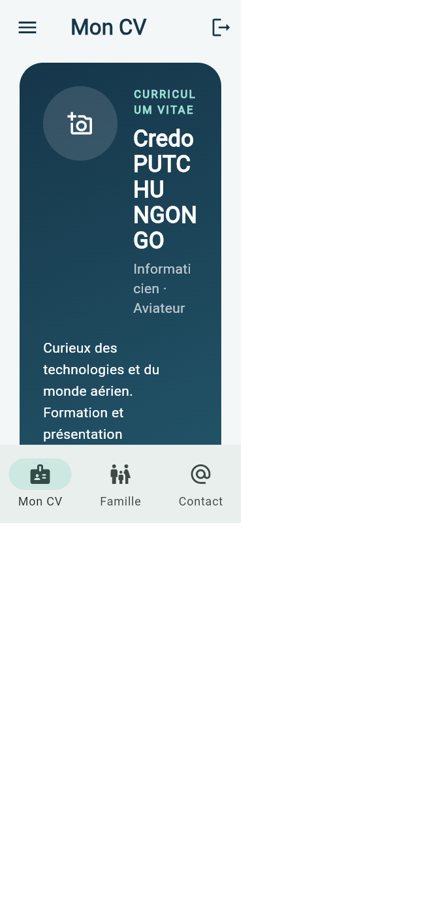
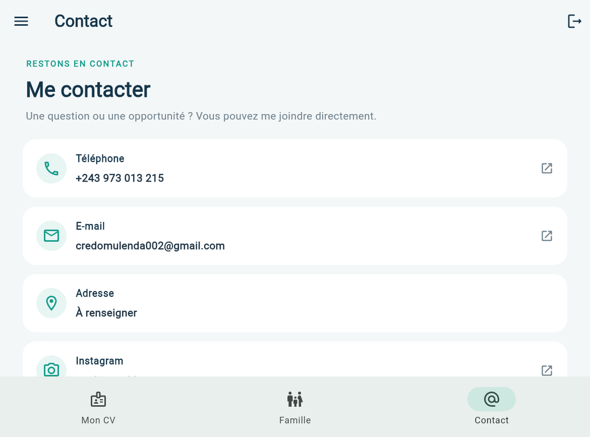

# CV Flutter — Credo PUTCHU NGONGO

Application Flutter multiplateforme qui présente mon CV, ma famille et mes
coordonnées. L’interface est en français et la navigation se fait par barre
inférieure ou par menu latéral.

## Captures d’écran

| Connexion | Mon CV |
|---|---|
|  |  |

| Ma famille | Contact |
|---|---|
|  |  |

## Connexion de démonstration

- **Identifiant :** `credo`
- **Mot de passe :** `123456`

Cette connexion locale sert uniquement à la démonstration. Elle ne remplace
pas un système d’authentification sécurisé pour une application en production.

## Lancer l’application

Installez [Flutter](https://docs.flutter.dev/get-started/install), puis lancez
les commandes suivantes à la racine du projet :

```bash
flutter pub get
flutter run
```

Les plateformes Android, iOS, Web, Windows et Linux sont configurées.

## Informations à compléter

Les données communiquées sont déjà intégrées. Les éléments suivants sont laissés
à compléter plutôt que d’inventer des informations personnelles :

- Ajouter les photos des membres de la famille.
- Ajouter la formation, ses dates, les détails des expériences, les compétences,
  les niveaux de langue et les centres d’intérêt.
- Ajouter votre adresse ainsi que vos liens LinkedIn et GitHub.

## Dépôt public

Le projet est publié dans le dépôt public
[PutchuNgongoCredo/cv_flutter_credo](https://github.com/PutchuNgongoCredo/cv_flutter_credo).
