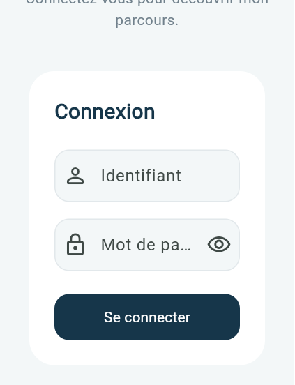
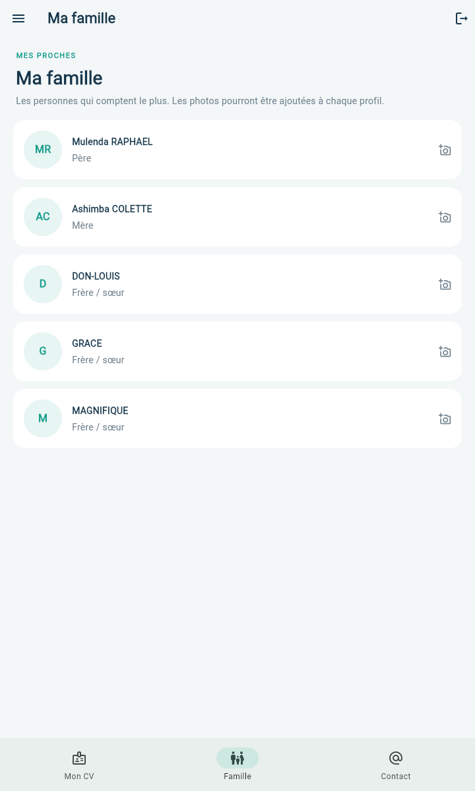

# CV Flutter — Credo PUTCHU NGONGO

Application Flutter multiplateforme qui présente mon CV, ma famille et mes
coordonnées. L’authentification et la gestion des membres de famille utilisent
l’API PHP/MySQL du TP : les comptes et les membres sont enregistrés dans la base
de données, et non uniquement dans l’application.

## Captures d’écran

| Connexion | Mon CV |
|---|---|
|  |  |

| Ma famille | Contact |
|---|---|
|  |  |

## API et configuration WAMP

L’API à installer est [espoirbaraka/api-test](https://github.com/espoirbaraka/api-test).
Elle requiert Apache, PHP et MySQL/MariaDB. Avec WAMP sous Windows :

1. Démarrez les services Apache et MySQL depuis WampServer et attendez que
   l’icône soit verte.
2. Clonez ou copiez le dépôt `api-test` dans `C:\wamp64\www\api-test` (adaptez
   le chemin si WAMP est installé ailleurs).
3. Ouvrez phpMyAdmin depuis la page d’accueil WampServer (l’alias peut varier,
   par exemple `http://localhost/phpmyadmin5.2.3/`), créez la base `api`, puis
   importez le fichier `api.sql` fourni par le dépôt API.
4. Copiez `.env.example` vers `.env` dans `api-test` et renseignez les
   identifiants MySQL de WAMP. Pour une installation WAMP classique :

   ```env
   DB_HOST=127.0.0.1
   DB_PORT=3306
   DB_DATABASE=api
   DB_USERNAME=root
   DB_PASSWORD=
   ```

5. Vérifiez que l’API répond à
   `http://localhost/api-test/public/famille-membres`. Le segment `/public` est
   nécessaire. Créez un compte depuis l’écran de connexion de l’application.

La connexion utilise réellement `POST /accounts/login`; le lien « Créer un
compte » utilise `POST /accounts/register`. La page Famille charge les données
avec `GET /famille-membres` et permet l’ajout, la modification et la suppression
via les endpoints REST correspondants.

### Adresse de l’API selon la plateforme

L’adresse par défaut pour WAMP sur le même ordinateur est
`http://localhost/api-test/public`. Si nécessaire, configurez l’adresse avec
`API_BASE_URL` :

```powershell
# Application Windows ou navigateur sur le PC qui héberge WAMP
flutter run -d windows --dart-define="API_BASE_URL=http://localhost/api-test/public"

# Émulateur Android : 10.0.2.2 désigne le PC hôte
flutter devices
flutter run -d emulator-5554 --dart-define="API_BASE_URL=http://10.0.2.2/api-test/public"
```

Remplacez `emulator-5554` par l’identifiant affiché par `flutter devices`.
Sur un téléphone physique, remplacez `localhost` par l’adresse IP locale du PC
qui exécute WAMP et vérifiez que le pare-feu autorise Apache sur le réseau
privé. Le téléphone et le PC doivent être sur le même réseau. L’API autorise
les requêtes CORS pour Flutter Web. Cette configuration de TP utilise HTTP ;
ne l’exposez pas telle quelle à Internet.

## Lancer l’application

Installez [Flutter](https://docs.flutter.dev/get-started/install), puis lancez
les commandes suivantes à la racine du projet :

```bash
flutter pub get
flutter run -d chrome --dart-define="API_BASE_URL=http://localhost/api-test/public"
```

Pour lancer l’application Windows native, activez le Mode développeur Windows
afin d’autoriser la création de liens symboliques, puis utilisez
`flutter run -d windows --dart-define="API_BASE_URL=http://localhost/api-test/public"`.
Les plateformes Android, iOS, Web, Windows et Linux sont configurées.

## Vidéo de démonstration

[Regarder la vidéo de démonstration du TP2](tp2.mp4).

## Dépôt

Le projet est publié dans le dépôt public
[PutchuNgongoCredo/cv_flutter_credo](https://github.com/PutchuNgongoCredo/cv_flutter_credo).
